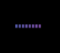
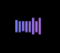

# Purple waveform tray: GNOME screenshots

These are actual GNOME top-bar captures of the native Rust SNI implementation.
Each image is cropped to the waveform's panel area and displayed at 4× size.
The visual QA preview uses prerecorded speech through Voxtype's audio-level
protocol and drives the idle, recording, and transcribing states explicitly;
these demonstrate the indicator rather than an end-to-end transcription session.

| Idle | Recording | Transcribing |
| --- | --- | --- |
|  |  |  |

Enable the style with:

```toml
[tray]
enabled = true
icon_style = "waveform"
```

GNOME needs an AppIndicator / KStatusNotifierItem extension. This native SNI
indicator is separate from the Omarchy Waybar custom status module.
